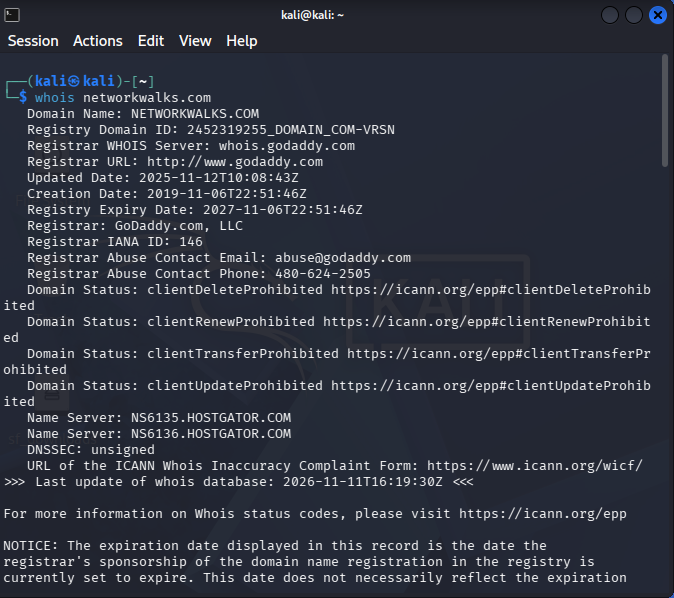
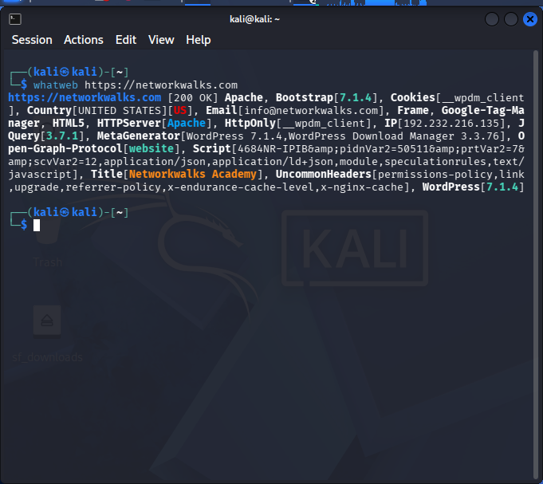
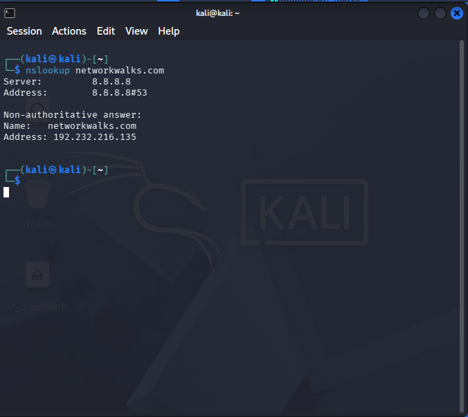
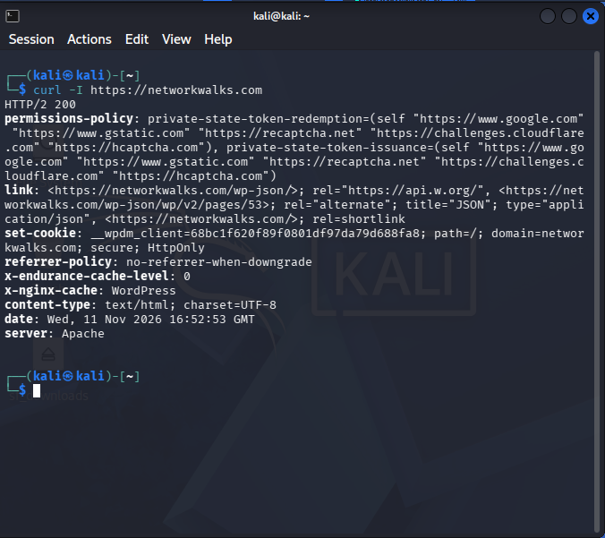
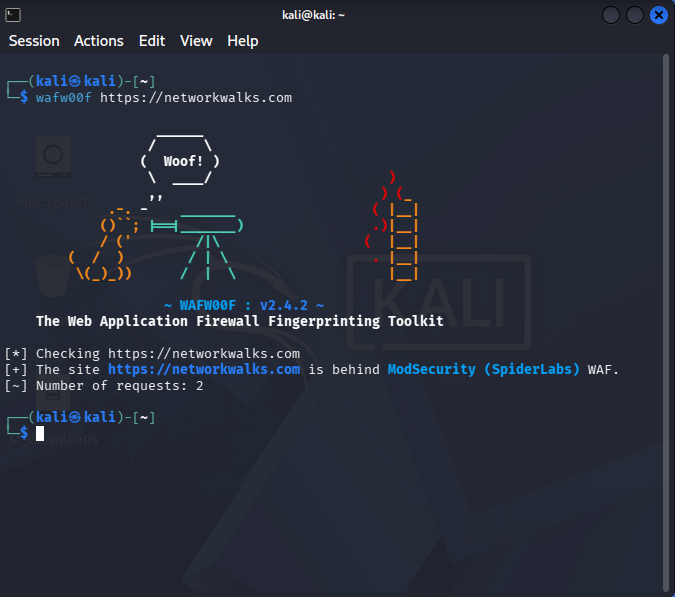
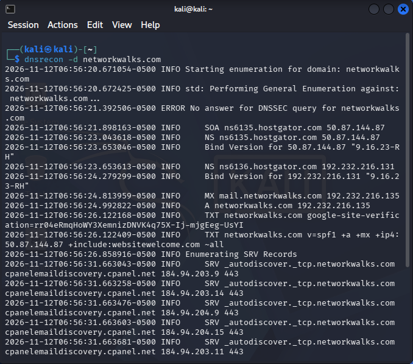
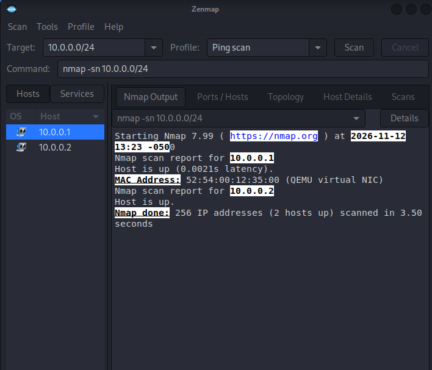
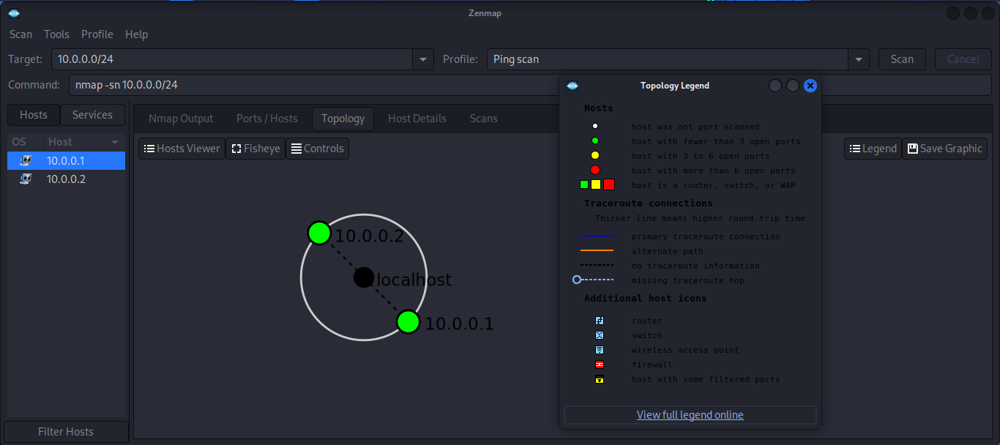

# PENETRATION TESTING REPORT

## WEEK 2 – CYBERSECURITY INTERNSHIP

| Report Information | Details |
|---|---|
| Pentester Name | MUTSIIRWA MATEMBERA JOSUE |
| Program | NetworkWalks Cybersecurity Internship |
| Batch | B084 |
| Date | 13 November 2026 |
| Modules Completed | W2-PM1 and W2-PM5 |
| Client/Target | networkwalks.com and Kali VirtualBox Lab Network |
| Permission Secured | Activities conducted within the assigned training exercise. Written authorization status should be confirmed with the program supervisor. |
| Phases Covered | Footprinting, Reconnaissance, DNS Enumeration and Network Scanning |

---

## 1. LIABILITY DISCLAIMER

This report documents cybersecurity practical activities performed as part of the NetworkWalks Week 2 training program.

The activities were conducted for educational purposes using the assigned training target and a locally configured Kali Linux VirtualBox environment.

No exploitation, destructive testing, or unauthorized access was attempted. The findings represent observations collected during the exercises and should not be interpreted as confirmation of security vulnerabilities.

## 2. INTRODUCTION

The purpose of this assessment was to develop practical knowledge of penetration testing techniques, including information gathering, domain reconnaissance, DNS enumeration, website technology identification and network scanning.

The first module focused on gathering publicly accessible information about `networkwalks.com` using reconnaissance tools.

The second module involved network discovery using Nmap and Zenmap within a Kali Linux VirtualBox virtual network.

## 3. TOOLS USED

| Tool | Purpose |
|---|---|
| WHOIS | Retrieve domain registration information |
| WhatWeb | Identify website technologies |
| Nslookup | Perform DNS resolution |
| cURL | Retrieve HTTP response headers |
| WAFW00F | Identify web application firewall technologies |
| DNSRecon | Perform DNS enumeration |
| Nmap | Discover active hosts on a network |
| Zenmap | Provide a graphical interface for network scanning and topology visualization |
| Kali Linux | Penetration testing environment |

## 4. ACTIVITIES PERFORMED

### 4.1 Footprinting and Reconnaissance (W2-PM1)

The target domain used for this exercise was `networkwalks.com`.

**1. WHOIS – Domain Registration Information**

WHOIS was used to retrieve publicly available domain registration information.

The results showed that the domain was registered through GoDaddy, with a creation date of 6 November 2019 and an expiry date of 6 November 2027.

The domain uses HostGator nameservers, and its WHOIS registration information is privacy protected. The WHOIS result indicated that DNSSEC was unsigned.

**2. WhatWeb – Website Technology Identification**

WhatWeb was used to identify technologies used by the target website.

The scan identified Apache as the web server and WordPress 7.1.4 as the content management system. It also identified WordPress Download Manager 3.3.76 and jQuery 3.7.1.

The website returned HTTP status 200, indicating that the request was successful.

**3. Nslookup – DNS Resolution**

Nslookup was used to resolve the target domain into its IP address.

The domain resolved to:

- IP Address: `192.232.216.135`
- DNS Server: `8.8.8.8`

This demonstrated how DNS translates a domain name into an IP address.

**4. cURL – HTTP Response Headers**

The cURL command was used to retrieve the HTTP response headers from the website.

The server returned an HTTP 200 OK response. The response identified Apache as the web server and included headers such as Content-Type, Referrer-Policy and Permissions-Policy.

The response also exposed a WordPress REST API reference through a Link header. This is an observation and does not by itself establish a vulnerability.

**5. WAFW00F – Web Application Firewall Detection**

WAFW00F was used to identify whether a web application firewall was protecting the target website.

The tool detected ModSecurity (SpiderLabs).

This indicates that a web application firewall technology was detected during the test.

**6. DNSRecon – DNS Enumeration**

DNSRecon was used to collect DNS records associated with the target domain.

The enumeration identified SOA, NS, MX, A, TXT and SRV records.

The results also exposed a DNS server version string: BIND 9.16.23-RH. The DNSSEC query did not return an answer, which was consistent with the unsigned status observed in WHOIS.

A total of eight DNS records were enumerated.

### 4.2 Network Scanning with Zenmap (W2-PM5)

The second practical exercise involved discovering active hosts within the Kali Linux VirtualBox virtual network.

The network range scanned was:

`10.0.0.0/24`

The Nmap command used was:

```bash
nmap -sn 10.0.0.0/24
```

The `-sn` option performs host discovery without conducting a port scan.

The scan identified two active hosts:

| IP Address | Status | MAC Address |
|---|---|---|
| 10.0.0.1 | Up | 52:54:00:12:35:00 |
| 10.0.0.2 | Up | Not displayed |

The first address represented the virtual network gateway, while the second represented the Kali Linux virtual machine.

Zenmap was also used to visualize the discovered network topology, and the topology was saved as a PDF.

**Network Scan Summary:**

- Network scanned: `10.0.0.0/24`
- Total IP addresses scanned: 256
- Active hosts discovered: 2
- Scan type: Ping Scan / Host Discovery
- Port scanning: Not performed

**Environment Limitation:**

The scan was performed within the Kali Linux VirtualBox NAT virtual network. It did not represent a scan of the physical Wi-Fi network or all devices connected to the physical LAN.

## 5. RISK ANALYSIS / IMPACT

The following table summarizes observations made during the exercises. Risk levels are preliminary indicators of potential exposure, not confirmed vulnerability ratings.

| No. | Finding / Observation | Evidence / Observation | Potential Impact | Risk Level |
|---|---|---|---|---|
| 1 | Web technology information | WhatWeb identified Apache and WordPress versions. | Technology information may assist an attacker during reconnaissance. | Low |
| 2 | DNS server version disclosure | DNSRecon returned a BIND version string. | Version information could help an attacker research possible weaknesses. | Low |
| 3 | DNSSEC unsigned | WHOIS indicated that DNSSEC was unsigned. | DNS responses may lack DNSSEC-based authenticity validation. | Informational |
| 4 | WordPress REST API reference | cURL exposed a WordPress REST API reference in the response headers. | Public API information may reveal application endpoints. | Informational |
| 5 | Web application firewall detected | WAFW00F identified ModSecurity. | This is a security control observed, not a vulnerability. | Informational |
| 6 | Limited network discovery | Nmap identified two active hosts in the VirtualBox network. | The scan provided visibility only into discovered hosts, not their open ports or services. | Informational |

No exploitable vulnerability was confirmed during these exercises.

## 6. RECOMMENDATIONS

1. **Keep Software Updated:** Regularly update WordPress, plugins, web server software and other components to supported secure versions.

2. **Review Technology Exposure:** Avoid unnecessarily exposing detailed software version information in public responses.

3. **Review DNS Configuration:** Evaluate DNS security settings and consider enabling DNSSEC where appropriate.

4. **Secure DNS Services:** Keep DNS software updated and restrict unnecessary DNS information disclosure.

5. **Maintain Web Application Firewall Protection:** Continue monitoring and maintaining the detected ModSecurity protection.

6. **Review HTTP Security Headers:** Ensure appropriate security headers are configured according to the website's requirements.

7. **Review WordPress Security:** Regularly review installed plugins, user accounts, permissions and available updates.

8. **Conduct Further Authorized Testing:** Perform additional security assessments only within an explicitly approved scope.

9. **Maintain Network Visibility:** Use regular network discovery and asset inventory activities to identify devices connected to authorized networks.

## 7. CONCLUSION

The Week 2 practical exercises provided hands-on experience with domain reconnaissance, DNS enumeration, website technology identification and network discovery.

Using WHOIS, WhatWeb, Nslookup, cURL, WAFW00F and DNSRecon, publicly accessible information about the assigned target domain was collected and documented.

Using Nmap and Zenmap, two active hosts were identified within the Kali Linux VirtualBox virtual network, and a network topology diagram was generated.

The exercises improved practical understanding of reconnaissance tools, DNS records, HTTP responses, firewall detection and network host discovery.

No exploitation was performed, and no vulnerability was confirmed during the assessment.

## 8. EVIDENCES COLLECTED

### 8.1 W2-PM1 – Domain Reconnaissance

**Figure 1: WHOIS Domain Information**



**Figure 2: WhatWeb Technology Identification**



**Figure 3: Nslookup DNS Resolution**



**Figure 4: cURL HTTP Response Headers**



**Figure 5: WAFW00F Firewall Detection**



**Figure 6: DNSRecon Enumeration**



### 8.2 W2-PM5 – Network Scanning

**Figure 7: Nmap Host Discovery**



**Figure 8: Zenmap Network Topology**



## 9. AUTHOR AND PROJECT INFORMATION

**Pentester:** MUTSIIRWA MATEMBERA JOSUE

**Program:** NetworkWalks Cybersecurity Internship

**Batch:** B084

**Project:** Week 2 – Penetration Testing

**LinkedIn:** https://www.linkedin.com/in/josue-matembera-37a269407/

**GitHub Repository:**  
https://github.com/josuemutsiirwa/NETWORKWALKS-MUTSIIRWA-B084-WK2-PENETRATION-TESTING

---
