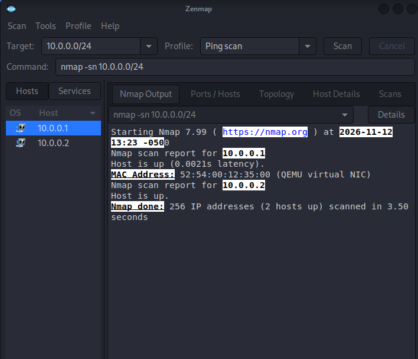
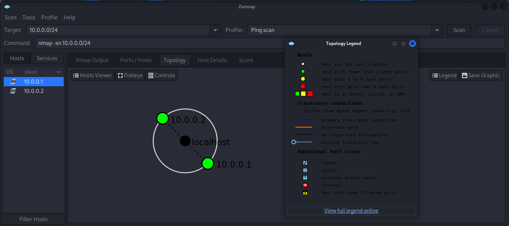

<div align="center">

# NETWORKWALKS CYBERSECURITY INTERNSHIP

### WEEK 2 — PENETRATION TESTING & NETWORK SCANNING

[](https://networkwalks.com/)
[](#)
[](#)
[](https://www.kali.org/)

**Practical cybersecurity exercises documenting reconnaissance, information gathering, network discovery, and network topology visualization.**

</div>

---

## About This Project

This repository contains my practical work for **Week 2 of the NetworkWalks Cybersecurity Internship (Batch B084)**.

The purpose of this week's activities was to develop practical cybersecurity skills through information gathering, reconnaissance, network scanning, host discovery, and network topology visualization.

The exercises were performed using Kali Linux and cybersecurity tools, with supporting screenshots, command outputs, and documentation included as evidence.

## Intern Information

| Information | Details |
|---|---|
| **Name** | MUTSIIRWA MATEMBERA JOSUE |
| **Program** | NetworkWalks Cybersecurity Internship |
| **Batch** | B084 |
| **Week** | Week 2 |
| **Focus Area** | Penetration Testing & Network Scanning |
| **Operating System** | Kali Linux |
| **GitHub** | [josuemutsiirwa](https://github.com/josuemutsiirwa) |
| **LinkedIn** | [Josue Matembera](https://www.linkedin.com/in/josue-matembera-37a269407/) |

---

## Project Objectives

The main objectives of this week's practical exercises were to:

- Understand the fundamentals of penetration testing and reconnaissance.
- Gather publicly available information about a target domain.
- Identify domain registration and DNS information.
- Analyze web technologies and HTTP response headers.
- Identify possible Web Application Firewall (WAF) technologies.
- Perform network host discovery using Nmap.
- Visualize discovered network devices using Zenmap.
- Document findings and identify potential security considerations.

## Tools and Technologies

| Tool | Purpose |
|---|---|
| Kali Linux | Penetration testing environment |
| WHOIS | Domain registration information gathering |
| WhatWeb | Website technology identification |
| Nslookup | DNS lookup and IP resolution |
| cURL | HTTP request and response inspection |
| WAFW00F | Web Application Firewall detection |
| DNSRecon | DNS enumeration |
| Nmap | Network discovery and scanning |
| Zenmap | Graphical network scanning and topology visualization |

---

## Practical Modules

### Module 1 — Website Reconnaissance and Information Gathering (PM1)

<kbd>W2-PM1</kbd>

This module focused on gathering publicly available information about the target domain, `networkwalks.com`.

The following activities were performed:

1. **WHOIS:** Retrieved domain registration and registrar information.
2. **WhatWeb:** Identified web technologies and server information.
3. **Nslookup:** Resolved the target domain to its IP address.
4. **cURL:** Inspected HTTP response headers.
5. **WAFW00F:** Checked for the presence of a Web Application Firewall.
6. **DNSRecon:** Enumerated publicly available DNS records.

**Evidence and outputs:**

- Screenshots are stored in `W2-PM1/screenshots/`.
- Command outputs are stored in `W2-PM1/outputs/`.

### Module 5 — Network Scanning and Topology Visualization (PM5)

<kbd>W2-PM5</kbd>

This module focused on identifying active hosts within the assigned virtual network and visualizing the discovered network topology.

The following activities were performed:

1. Identified the Kali Linux virtual machine's network configuration.
2. Performed host discovery using Nmap.
3. Identified active hosts within the `10.0.0.0/24` network.
4. Used Zenmap to visualize the discovered network topology.
5. Saved screenshots and scan results as evidence.

**Key observation:**

The host discovery scan identified two active hosts:

- `10.0.0.1` — Virtual network gateway.
- `10.0.0.2` — Kali Linux virtual machine.

The scan used Nmap's `-sn` option, which performs host discovery without conducting a port scan.

**Evidence and outputs:**

- Screenshots are stored in `W2-PM5/screenshots/`.
- Scan results and the topology PDF are stored in `W2-PM5/outputs/`.

---

## Repository Structure

```text
NETWORKWALKS-MUTSIIRWA-B084-WK2-PENETRATION-TESTING/
│
├── README.md
│
├── WEEK-2-PENETRATION-TESTING-REPORT.md
│
├── W2-PM1/
│   ├── screenshots/
│   │   ├── 01-whois.png
│   │   ├── 02-whatweb.png
│   │   ├── 03-nslookup.png
│   │   ├── 04-curl.png
│   │   ├── 05-wafw00f.png
│   │   └── 06-dnsrecon.png
│   │
│   └── outputs/
│       ├── whois.txt
│       ├── whatweb.txt
│       ├── nslookup.txt
│       ├── curl.txt
│       ├── wafw00f.txt
│       └── dnsrecon.txt
│
└── W2-PM5/
    ├── screenshots/
    │   ├── 01-kali-ping-scan.png
    │   └── 02-kali-network-topology.png
    │
    └── outputs/
        ├── kali-ping-scan.txt
        └── W2-PM5-Network-Topology.pdf
```

---

## Screenshots and Practical Evidence

The repository includes screenshots demonstrating the practical activities performed during the internship.

### PM1 — Website Reconnaissance

| Activity | Evidence |
|---|---|
| WHOIS lookup | `W2-PM1/screenshots/01-whois.png` |
| Technology identification | `W2-PM1/screenshots/02-whatweb.png` |
| DNS lookup | `W2-PM1/screenshots/03-nslookup.png` |
| HTTP header inspection | `W2-PM1/screenshots/04-curl.png` |
| WAF detection | `W2-PM1/screenshots/05-wafw00f.png` |
| DNS enumeration | `W2-PM1/screenshots/06-dnsrecon.png` |

### PM5 — Network Scanning

**Nmap Host Discovery**



**Zenmap Network Topology**



---

## Formal Penetration Testing Report

The complete formal report is available below:

**[WEEK 2 — PENETRATION TESTING REPORT](WEEK-2-PENETRATION-TESTING-REPORT.md)**

The report contains:

- Introduction and objectives.
- Tools and technologies used.
- Detailed activities performed.
- Findings and observations.
- Risk analysis and potential security implications.
- Recommendations.
- Evidence collected.
- Conclusion and author information.

---

## Key Learning Outcomes

Through these practical exercises, I gained experience in:

- Performing basic website reconnaissance.
- Understanding domain registration and DNS information.
- Identifying web technologies and server responses.
- Understanding the role of Web Application Firewalls.
- Using Nmap for network host discovery.
- Using Zenmap to visualize network topology.
- Organizing technical evidence and documenting security findings.

---

## Disclaimer

This repository is intended for educational and training purposes as part of the NetworkWalks Cybersecurity Internship.

All activities should be performed only within authorized environments and within the scope approved by the relevant system or network owner.

The information documented in this repository represents observations from the practical exercises. It does not constitute confirmation that the assessed systems contain exploitable vulnerabilities.

---

<div align="center">

### Author

**MUTSIIRWA MATEMBERA JOSUE**

NetworkWalks Cybersecurity Internship — Batch B084

[GitHub](https://github.com/josuemutsiirwa) • [LinkedIn](https://www.linkedin.com/in/josue-matembera-37a269407/)

**WEEK 2 — PENETRATION TESTING & NETWORK SCANNING**

</div>
