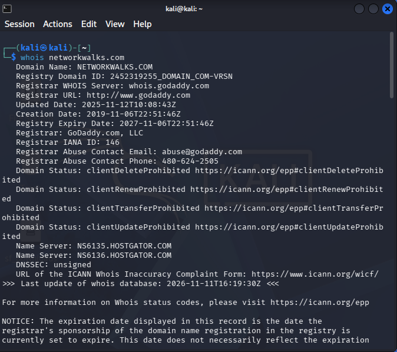
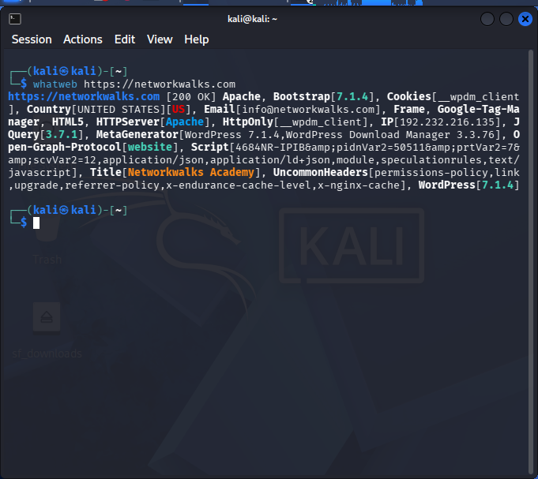
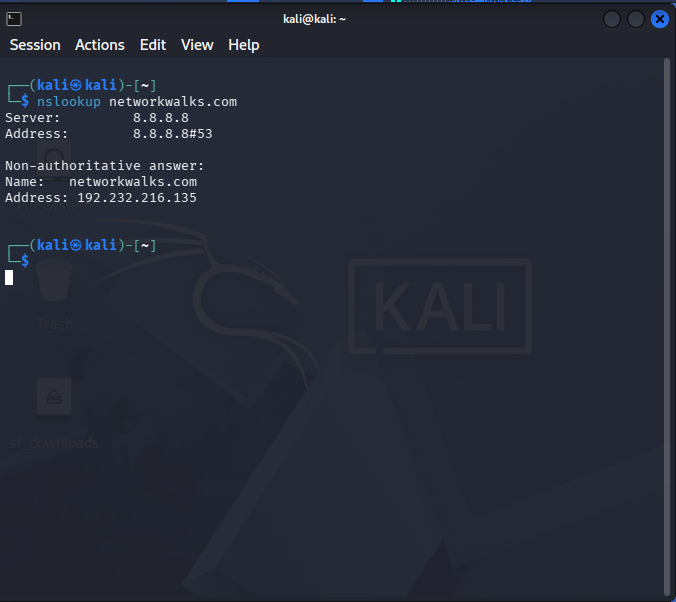
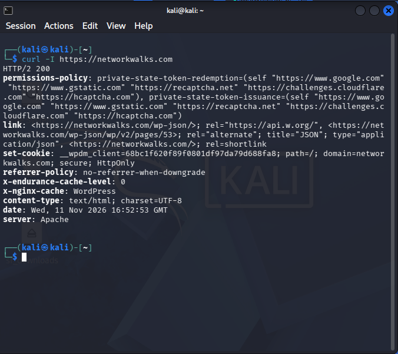
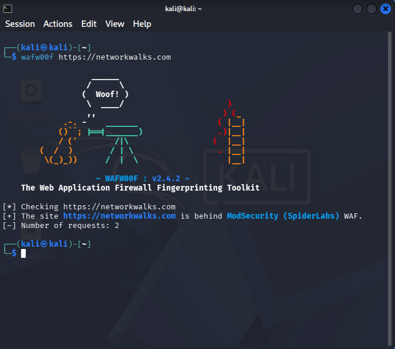
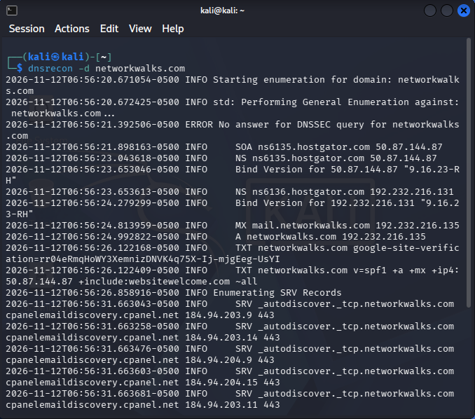
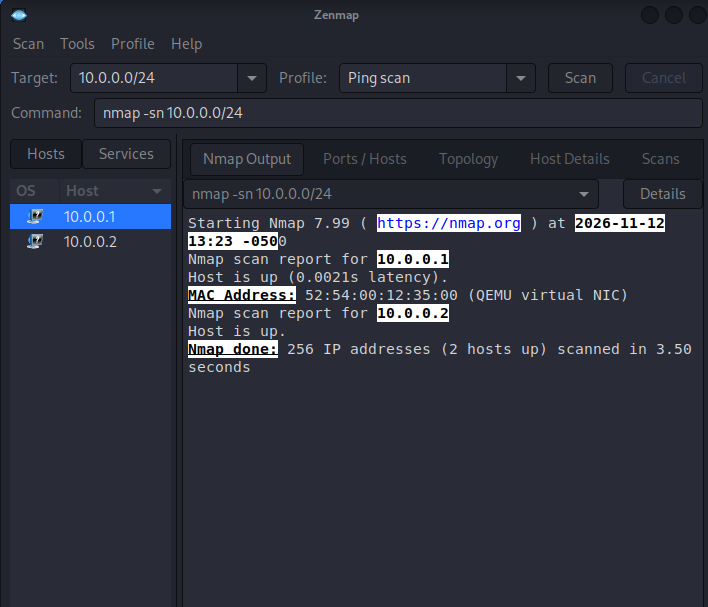
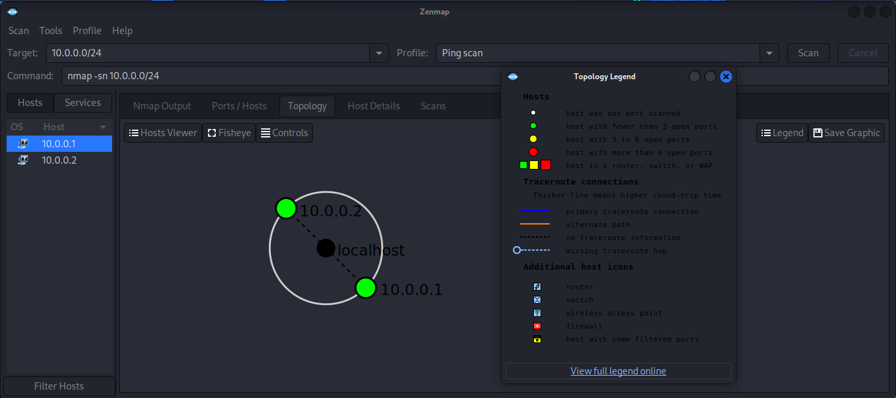

<div align="center">

# PENETRATION TESTING REPORT

### FOOTPRINTING, RECONNAISSANCE AND NETWORK SCANNING

**W2-PM-FINAL | NETWORKWALKS CYBERSECURITY INTERNSHIP**


**PREPARED BY**

### MUTSIIRWA MATEMBERA JOSUE

**BATCH B084**

[LinkedIn](https://www.linkedin.com/in/josue-matembera-37a269407/) | [GitHub](https://github.com/josuemutsiirwa)

</div>

---

## REPORT INFORMATION

| Report Information | Details |
|---|---|
| Pentester Name | MUTSIIRWA MATEMBERA JOSUE |
| Program | NetworkWalks Cybersecurity Internship |
| Batch | B084 |
| Date | 13 November 2026 |
| Modules Completed | W2-PM1 and W2-PM5 |
| Primary Target | `networkwalks.com` |
| Scanning Environment | Kali Linux VirtualBox virtual network |
| Phases Covered | Footprinting, Reconnaissance, DNS Enumeration and Network Scanning |
| Report Type | Week 2 Practical Penetration Testing Report |

> **Authorization note:** This report documents the assigned training activities and their observed results. The written authorization status for testing the external domain should be confirmed with the program supervisor. No exploitation or destructive testing was performed.

## TABLE OF CONTENTS

1. [Liability Disclaimer](#1-liability-disclaimer)
2. [Executive Summary](#2-executive-summary)
3. [Introduction](#3-introduction)
4. [Objectives](#4-objectives)
5. [Tools and Technologies Used](#5-tools-and-technologies-used)
6. [Methodology and Activities Performed](#6-methodology-and-activities-performed)
7. [Risk Analysis and Security Observations](#7-risk-analysis-and-security-observations)
8. [Recommendations](#8-recommendations)
9. [Limitations of the Assessment](#9-limitations-of-the-assessment)
10. [Evidence Collected](#10-evidence-collected)
11. [Conclusion](#11-conclusion)
12. [Author and Project Information](#12-author-and-project-information)

---

# 1. LIABILITY DISCLAIMER

This report documents practical cybersecurity activities completed as part of the NetworkWalks Cybersecurity Internship.

The activities described were conducted for educational and security-learning purposes within the assigned practical scope. Domain reconnaissance used `networkwalks.com` as the assigned training target, while network discovery was restricted to the Kali Linux VirtualBox virtual network used for the laboratory exercise.

No exploitation, unauthorized access, data modification or disruption of services was performed as part of these two modules.

The observations in this report should not be interpreted as proof that the target systems contain exploitable vulnerabilities. Any additional testing must be conducted only with appropriate authorization and within an explicitly approved scope.

The author accepts responsibility for using the knowledge gained from these exercises ethically and lawfully.

# 2. EXECUTIVE SUMMARY

This report presents the results of two practical cybersecurity modules completed during Week 2 of the NetworkWalks Cybersecurity Internship.

The assessment focused on two important areas of penetration testing:

- **W2-PM1 – Footprinting and Reconnaissance:** Information gathering and analysis using six Kali Linux tools.
- **W2-PM5 – Network Scanning:** Host discovery and network topology visualization using Nmap and Zenmap.

During W2-PM1, the domain `networkwalks.com` was examined using WHOIS, WhatWeb, Nslookup, cURL, WAFW00F and DNSRecon.

The investigation identified Apache and WordPress technologies, resolved the domain to `192.232.216.135`, detected ModSecurity and collected DNS records associated with the domain.

During W2-PM5, Nmap was used to discover active hosts within the `10.0.0.0/24` VirtualBox network. Two active hosts were identified: the virtual network gateway and the Kali Linux virtual machine. Zenmap was also used to visualize the discovered network topology.

The exercises provided practical experience in reconnaissance, DNS analysis, HTTP response inspection, firewall detection and network discovery.

No exploitation was performed, and no confirmed exploitable vulnerability was established.

# 3. INTRODUCTION

Penetration testing is a security assessment process used to evaluate systems, networks and applications for potential security weaknesses.

An important part of this process involves gathering information about a target before conducting more advanced security testing.

During Week 2 of the NetworkWalks Cybersecurity Internship, practical activities focused on reconnaissance, footprinting and network scanning.

The first module, W2-PM1, involved using multiple Kali Linux tools to collect publicly available information about `networkwalks.com`. The exercise covered domain registration, website technologies, DNS infrastructure, HTTP response headers and web application firewall detection.

The second module, W2-PM5, involved network discovery using Nmap and Zenmap. The objective was to identify active hosts within the Kali Linux VirtualBox virtual network and generate a visual network topology.

This report documents the methodology, commands, observations, potential security implications, recommendations and evidence collected during both modules.

# 4. OBJECTIVES

The main objectives of the Week 2 practical exercises were:

1. Understand the fundamentals of footprinting and reconnaissance.
2. Retrieve publicly available domain registration information using WHOIS.
3. Identify website technologies using WhatWeb.
4. Understand DNS resolution using Nslookup.
5. Examine HTTP response headers using cURL.
6. Detect web application firewall technologies using WAFW00F.
7. Enumerate DNS records using DNSRecon.
8. Perform network host discovery using Nmap.
9. Visualize network topology using Zenmap.
10. Document technical findings and identify areas requiring further security review.

# 5. TOOLS AND TECHNOLOGIES USED

| Tool | Purpose |
|---|---|
| Kali Linux | Operating system used for cybersecurity activities |
| WHOIS | Retrieves domain registration information |
| WhatWeb | Identifies website technologies and components |
| Nslookup | Performs DNS queries and domain resolution |
| cURL | Retrieves HTTP responses and headers |
| WAFW00F | Detects web application firewall technologies |
| DNSRecon | Performs DNS enumeration |
| Nmap | Performs network discovery and host identification |
| Zenmap | Graphical interface for Nmap and topology visualization |
| Oracle VirtualBox | Provides the virtual laboratory environment |

# 6. METHODOLOGY AND ACTIVITIES PERFORMED

## 6.1 W2-PM1 – FOOTPRINTING AND RECONNAISSANCE

### Target Information

The target domain used for this practical exercise was:

`networkwalks.com`

Six Kali Linux tools were used to gather different categories of publicly available information.

### 6.1.1 WHOIS – Domain Registration Information

**Command executed:**

```bash
whois networkwalks.com
```

**Purpose:**

WHOIS retrieves publicly available domain registration information, including the registrar, registration dates, expiry dates and authoritative name servers.

**Observations:**

The WHOIS query returned the following information:

| Information | Result |
|---|---|
| Registrar | GoDaddy |
| Creation Date | 6 November 2019 |
| Expiration Date | 6 November 2027 |
| DNSSEC | Unsigned |
| Nameservers | `NS6135.HOSTGATOR.COM` and `NS6136.HOSTGATOR.COM` |
| Registration Privacy | Enabled |

**Security relevance:**

Domain registration information helps security professionals understand the administrative and DNS infrastructure associated with a domain.

Nameserver information can also support further DNS investigation.

The availability of registration information is not itself a vulnerability, but it contributes to the information that can be collected during reconnaissance.

**Evidence – Figure 1: WHOIS Domain Registration**



### 6.1.2 WhatWeb – Website Technology Identification

**Command executed:**

```bash
whatweb https://networkwalks.com
```

**Purpose:**

WhatWeb identifies technologies used by websites, including web servers, content management systems, frameworks, libraries and other detectable components.

**Observations:**

The scan identified the following technologies and information:

| Component | Detected Information |
|---|---|
| HTTP Response | `200 OK` |
| Web Server | Apache |
| CMS | WordPress 7.1.4 |
| Plugin | WordPress Download Manager 3.3.76 |
| JavaScript Library | jQuery 3.7.1 |
| Server IP | `192.232.216.135` |
| Website Title | Networkwalks Academy |

**Security relevance:**

Technology identification helps security professionals understand the software components used by a web application.

Identified software versions can be compared with reliable security advisories to determine whether further investigation is necessary.

However, detecting a software version does not establish that it is vulnerable. Verification would require checking the exact component, configuration, patch status and applicable security advisories.

**Evidence – Figure 2: WhatWeb Technology Identification**



### 6.1.3 Nslookup – DNS Resolution

**Command executed:**

```bash
nslookup networkwalks.com
```

**Purpose:**

Nslookup is a DNS query utility used to retrieve information from DNS servers.

It was used to determine the IP address associated with the target domain.

**Observations:**

| Information | Result |
|---|---|
| DNS Server | `8.8.8.8` |
| Resolved IPv4 Address | `192.232.216.135` |

The domain successfully resolved to its associated IPv4 address.

**Security relevance:**

DNS resolution provides information about the IP address associated with a domain.

This information can help security professionals understand where a web service is hosted and support further infrastructure investigation.

Public DNS resolution is normal website behavior and is not, by itself, a security vulnerability.

**Evidence – Figure 3: Nslookup DNS Resolution**



### 6.1.4 cURL – HTTP Response Header Analysis

**Command executed:**

```bash
curl -I https://networkwalks.com
```

**Purpose:**

cURL is a command-line tool used to communicate with web servers.

The `-I` option requests HTTP response headers without downloading the full page content.

**Observations:**

The server returned:

`HTTP/1.1 200 OK`

Additional observations included:

- Server information identifying Apache.
- Content-Type indicating HTML with UTF-8 encoding.
- A WordPress REST API reference exposed through the `Link` header: `/wp-json/`.
- A `__wpdm_client` cookie with Secure and HttpOnly attributes.
- Additional response and cache-related headers.

**Security relevance:**

HTTP response headers provide useful information about how a web server responds to requests.

They may reveal server technologies, application behavior and available endpoints.

The presence of a WordPress REST API reference does not automatically establish a vulnerability. Its access controls and exposed functionality would require separate authorized testing.

**Evidence – Figure 4: cURL HTTP Response Headers**



### 6.1.5 WAFW00F – Web Application Firewall Detection

**Command executed:**

```bash
wafw00f https://networkwalks.com
```

**Purpose:**

WAFW00F is used to identify whether a website is protected by a Web Application Firewall (WAF).

A WAF helps monitor and filter HTTP traffic according to configured security rules.

**Observations:**

The tool detected:

| Information | Result |
|---|---|
| Firewall | ModSecurity |
| Identification | ModSecurity (SpiderLabs) |

**Security relevance:**

A WAF can help protect web applications by filtering suspicious requests and reducing exposure to certain web-based attacks.

Identifying the technology provides information about the website's security architecture.

However, detection alone does not prove that the WAF is correctly configured or that it blocks every attack.

**Evidence – Figure 5: WAFW00F Firewall Detection**



### 6.1.6 DNSRecon – DNS Enumeration

**Command executed:**

```bash
dnsrecon -d networkwalks.com
```

**Purpose:**

DNSRecon is a DNS enumeration tool used to collect information about a domain's DNS infrastructure.

It can identify records such as A, NS, MX, SOA, TXT and SRV records.

**Observations:**

The enumeration identified:

- SOA records.
- Authoritative nameserver records.
- Mail exchange (MX) records.
- IPv4 address records.
- TXT records, including SPF-related information.
- SRV records associated with services such as autodiscover.
- DNS software version string: `BIND 9.16.23-RH`.
- DNSSEC query with no answer, consistent with the unsigned status observed in WHOIS.

DNSRecon reported eight records during the enumeration.

**Security relevance:**

DNS records can reveal information about an organization's domain infrastructure, mail services and other network-related services.

This information helps security professionals understand publicly visible DNS configuration and identify records that may require further review.

The discovery of DNS records does not automatically indicate a weakness. Their security significance depends on their configuration and intended purpose.

**Evidence – Figure 6: DNSRecon Enumeration**



---

## 6.2 W2-PM5 – NETWORK SCANNING USING NMAP AND ZENMAP

### 6.2.1 Overview

The second practical exercise focused on identifying active devices within a network using Nmap and its graphical interface, Zenmap.

The Kali Linux virtual machine was used to perform host discovery on the VirtualBox virtual network.

**Network scope:**

```text
10.0.0.0/24
```

This network represents the virtual laboratory environment, not the physical Wi-Fi network.

### 6.2.2 Nmap Host Discovery

**Command executed:**

```bash
nmap -sn 10.0.0.0/24
```

**Purpose:**

Nmap is a network scanning tool used to discover hosts and examine network services.

The `-sn` option performs host discovery without conducting a port scan.

It helps determine which devices are responding within the specified network range.

**Observations:**

The scan identified two active hosts:

| IP Address | Status | MAC Address | Identification |
|---|---|---|---|
| `10.0.0.1` | Up | `52:54:00:12:35:00` | QEMU virtual NIC / Gateway |
| `10.0.0.2` | Up | Not displayed | Kali Linux VM |

**Network Scan Summary:**

| Parameter | Result |
|---|---|
| Network Range | `10.0.0.0/24` |
| Total IP Addresses Scanned | 256 |
| Active Hosts | 2 |
| Scan Type | Ping Scan / Host Discovery |
| Port Scanning | Not performed |

**Security relevance:**

Host discovery helps administrators and security professionals understand which devices are active on a network.

It can assist with network inventory, identification of unexpected devices and preparation for further authorized security assessments.

Discovering an active host does not establish that the device is vulnerable. Additional authorized checks would be required to identify running services or security weaknesses.

**Evidence – Figure 7: Nmap Host Discovery**



### 6.2.3 Zenmap Network Topology Visualization

**Purpose:**

Zenmap provides a graphical interface for Nmap and makes it easier to view scan results and understand the discovered network environment.

After performing host discovery, the topology view was used to represent the discovered hosts visually.

**Observations:**

The topology represented the discovered devices in the Kali VirtualBox virtual network.

The visualization provided a graphical understanding of the network discovery results.

The topology was saved as a PDF document for documentation and submission.

**Evidence – Figure 8: Zenmap Network Topology**



**Additional topology document:**

[View W2-PM5 Network Topology PDF](W2-PM5/outputs/W2-PM5-Network-Topology.pdf)

### 6.2.4 Network Scanning Limitations

The scan was restricted to the Kali Linux VirtualBox virtual network rather than the physical Wi-Fi LAN.

The exercise demonstrated host discovery, but it did not include:

- A complete inventory of physical LAN devices.
- Port scanning or service version detection.
- Operating system fingerprinting.
- Vulnerability scanning or exploitation.

These activities would require separate authorized exercises and should not be inferred from the host discovery results.

# 7. RISK ANALYSIS AND SECURITY OBSERVATIONS

The following table summarizes observations made during the practical exercises and their possible security implications.

These are preliminary assessments of potential exposure, not confirmed vulnerabilities or formal vulnerability severity ratings.

| No. | Observation | Evidence | Potential Security Impact | Priority |
|---|---|---|---|---|
| 1 | Website technology information is publicly identifiable. | WhatWeb detected Apache, WordPress and plugin versions. | May help attackers identify software components requiring security review. | Low |
| 2 | Server IP address is publicly resolvable. | Nslookup returned `192.232.216.135`. | Provides infrastructure information that may support further reconnaissance. | Informational |
| 3 | HTTP response headers reveal technical information. | cURL returned server and application-related headers. | May assist technology fingerprinting and further enumeration. | Low |
| 4 | WordPress REST API endpoint is advertised. | cURL exposed `/wp-json/` in the Link header. | May reveal application endpoints and publicly accessible API information. | Informational |
| 5 | WAF technology is identifiable. | WAFW00F detected ModSecurity (SpiderLabs). | Reveals information about the web application's defensive technology. | Informational |
| 6 | DNS infrastructure records are publicly available. | DNSRecon identified SOA, NS, MX, TXT and SRV records. | May assist infrastructure mapping and targeted reconnaissance. | Low |
| 7 | DNSSEC was reported as unsigned. | WHOIS result and DNSRecon observation. | DNSSEC-based authenticity validation is not indicated by the observed configuration. | Informational |
| 8 | Two active hosts were discovered in the virtual network. | Nmap host discovery results. | Provides visibility into the laboratory network, but not the hosts' open ports or vulnerabilities. | Informational |

### Risk Assessment Notes

The priority labels are preliminary indicators of potential security implications.

The assessment did not include exploitation, authentication testing, configuration review or vulnerability validation.

Therefore, no confirmed exploitable vulnerability is claimed in this report.

# 8. RECOMMENDATIONS

Based on the observations collected during the practical exercises, the following recommendations are proposed.

### 8.1 Review Publicly Exposed Technology Information

Organizations should periodically review the technologies and software versions exposed by their websites.

Unnecessary information disclosure should be minimized where practical.

### 8.2 Maintain Updated Software

Content management systems, plugins, frameworks and server software should be maintained with appropriate security updates.

Detected versions should be checked against reliable security advisories.

### 8.3 Review HTTP Security Headers

Website administrators should review HTTP response headers and configure appropriate security headers according to application requirements.

Examples include:

- Content-Security-Policy
- X-Content-Type-Options
- Strict-Transport-Security
- Referrer-Policy

### 8.4 Review DNS Configuration

DNS records should be reviewed periodically to ensure that only necessary services and records are publicly exposed.

DNSSEC should also be considered where supported and appropriate for the organization's DNS infrastructure.

### 8.5 Maintain Web Application Firewall Protection

The detected ModSecurity WAF should be maintained, monitored and configured according to the application's security requirements.

Its effectiveness should be evaluated through authorized testing rather than assumed from detection alone.

### 8.6 Review WordPress Security

Website administrators should regularly review installed plugins, user accounts, permissions, software updates and exposed application endpoints.

### 8.7 Perform Regular Network Discovery

Organizations should periodically perform authorized network discovery to maintain an accurate inventory of active devices.

### 8.8 Investigate Unknown Devices

Unexpected devices discovered during network scans should be identified and verified by the network administrator.

### 8.9 Maintain Network Documentation

Network topology diagrams, IP address assignments and device inventories should be maintained and updated regularly.

### 8.10 Conduct Further Authorized Security Assessments

Reconnaissance and host discovery provide an initial understanding of an environment.

Additional authorized assessments may be required to examine open ports, running services, configurations and potential vulnerabilities.

# 9. LIMITATIONS OF THE ASSESSMENT

The following limitations should be considered when interpreting the results:

1. The reconnaissance exercise relied on information returned by the tools at the time of testing.
2. Technology identification does not establish the presence of vulnerabilities.
3. DNS enumeration was limited to the records returned during the exercise.
4. WAFW00F detection does not establish the effectiveness of the detected firewall.
5. The Nmap `-sn` scan performed host discovery only; it did not scan ports.
6. The network scan covered the VirtualBox virtual network and not the physical Wi-Fi LAN.
7. No exploitation, vulnerability validation or destructive testing was performed.

These limitations define the scope of the conclusions in this report.

# 10. EVIDENCE COLLECTED

The following screenshots and output files were collected to document the practical exercises.

## 10.1 W2-PM1 – FOOTPRINTING AND RECONNAISSANCE

**Figure 1: WHOIS – Domain Registration Information**


**Figure 2: WhatWeb – Website Technology Identification**


**Figure 3: Nslookup – DNS Resolution**


**Figure 4: cURL – HTTP Response Headers**


**Figure 5: WAFW00F – Web Application Firewall Detection**


**Figure 6: DNSRecon – DNS Enumeration**


## 10.2 W2-PM5 – NETWORK SCANNING

**Figure 7: Nmap – Kali Virtual Network Host Discovery**


**Figure 8: Zenmap – Network Topology Visualization**


### Additional Evidence Files

The following files provide additional technical records:

| File | Description |
|---|---|
| `W2-PM1/outputs/whois.txt` | WHOIS domain registration output |
| `W2-PM1/outputs/whatweb.txt` | Website technology identification output |
| `W2-PM1/outputs/nslookup.txt` | DNS resolution output |
| `W2-PM1/outputs/curl.txt` | HTTP response header output |
| `W2-PM1/outputs/wafw00f.txt` | WAF detection output |
| `W2-PM1/outputs/dnsrecon.txt` | DNS enumeration output |
| `W2-PM5/outputs/kali-ping-scan.txt` | Nmap host discovery output |
| `W2-PM5/outputs/W2-PM5-Network-Topology.pdf` | Generated network topology document |

# 11. CONCLUSION

During Week 2 of the NetworkWalks Cybersecurity Internship, I completed practical exercises covering footprinting, reconnaissance and network scanning.

In W2-PM1, I used six Kali Linux tools to gather information about the `networkwalks.com` domain.

WHOIS helped me understand domain registration information, WhatWeb identified website technologies, Nslookup demonstrated DNS resolution, cURL provided insight into HTTP response headers, WAFW00F identified a web application firewall, and DNSRecon provided additional information about DNS infrastructure.

In W2-PM5, I used Nmap and Zenmap to perform host discovery within my Kali Linux VirtualBox virtual network. I identified two active hosts and generated a network topology document to represent the discovered network environment.

These exercises improved my practical understanding of reconnaissance tools, DNS records, HTTP responses, firewall detection and network host discovery.

I also learned the importance of documenting commands, preserving evidence, interpreting results carefully and distinguishing between an observation and a confirmed security vulnerability.

Finally, these practical activities reinforced the importance of conducting cybersecurity assessments responsibly and only within an authorized scope.

# 12. AUTHOR AND PROJECT INFORMATION

| Information | Details |
|---|---|
| Pentester | MUTSIIRWA MATEMBERA JOSUE |
| Program | NetworkWalks Cybersecurity Internship |
| Batch | B084 |
| Project | Week 2 – Penetration Testing |
| Modules | W2-PM1 and W2-PM5 |

**LinkedIn:** [Josue Matembera](https://www.linkedin.com/in/josue-matembera-37a269407/)

**GitHub:** [josuemutsiirwa](https://github.com/josuemutsiirwa)

**Project Repository:**

[NETWORKWALKS-MUTSIIRWA-B084-WK2-PENETRATION-TESTING](https://github.com/josuemutsiirwa/NETWORKWALKS-MUTSIIRWA-B084-WK2-PENETRATION-TESTING)

---

<div align="center">

**NETWORKWALKS CYBERSECURITY INTERNSHIP**

**WEEK 02 – PENETRATION TESTING**

*Learning • Practicing • Securing*

---

**END OF REPORT**

</div>
